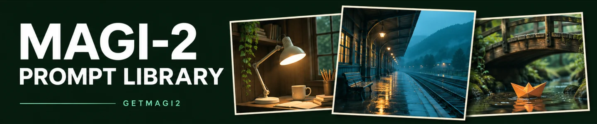

<a href="https://getmagi2.com/">
  
</a>

# Prompts de vídeo para MAGI-2

[EN](README.md) · [简体中文](README.zh-CN.md) · [日本語](README.ja-JP.md) · **Español**

Una biblioteca de prompts para MAGI-2, el modelo de vídeo de Sand.ai. Elige un punto de partida para anuncios de producto, escenas cinematográficas, diálogos, efectos de sonido o animación de miniaturas. Cada ficha reúne los ajustes sugeridos, los materiales necesarios y las comprobaciones para revisar el vídeo.

**Por uso** · [Producto y comercio electrónico](README.md#product-and-e-commerce) · [Escenas cinematográficas](README.md#cinematic-scenes) · [Diálogo y sonido](README.md#dialogue-and-sound) · [Miniaturas y animación](README.md#miniatures-and-animation)

**Por tipo de entrada** · [De texto a vídeo](PROMPTS.md#text-to-video) · [De imagen a vídeo](PROMPTS.md#image-to-video) · [De referencias a vídeo](PROMPTS.md#reference-to-video)

[Todos los prompts](README.md#all-prompts) · [Catálogo en inglés](PROMPTS.md) · [Vídeos oficiales de Sand.ai](README.md#official-video-gallery) · [Ejemplos en la portada de GetMagi2](https://getmagi2.com/#tool-generator)

Los prompts originales están en inglés. Las imágenes que los acompañan ilustran el guion gráfico. La sección de vídeos oficiales reúne demostraciones que Sand.ai publicó por separado.

## Anuncio vertical para una zapatilla de running

**De imagen a vídeo** · 8 segundos · 9:16 · Usa una foto vertical de tu zapatilla de running sin marca.

```text
Usa la foto de producto como primer fotograma de un anuncio vertical de ocho segundos. Conserva la forma real de la puntera, la disposición de los cordones, el color de la parte superior y el perfil de la suela. Entre los segundos 0 y 3, acerca lentamente la cámara desde el ángulo original de tres cuartos mientras una franja estrecha de luz de la ventana recorre la parte superior de la zapatilla. Entre los segundos 3 y 6, detén la cámara y deja que la luz revele las costuras y el dibujo de la suela de goma. Del segundo 6 al 8, mantén toda la zapatilla en cuadro. Añade un sonido ambiente tenue. Deja espacio libre sobre la zapatilla para añadir texto durante la edición.
```

Compara el contorno de la suela y cuenta los ojales en el primer y el último fotograma. Comprueba que la zapatilla entera queda dentro del encuadre vertical y que todavía hay sitio para el texto.

[Prompt original en inglés](PROMPTS.md#running-shoe-vertical-reveal) · [Abrir imagen a vídeo en GetMagi2](https://getmagi2.com/image-to-video?model=magi-2&utm_source=github&utm_medium=referral&utm_campaign=magi2_prompt_library&utm_content=running-shoe-vertical-reveal)

GetMagi2 es un estudio web independiente de Sand.ai. Revisa el modelo seleccionado, los ajustes y el coste en créditos que muestra el estudio antes de generar.
