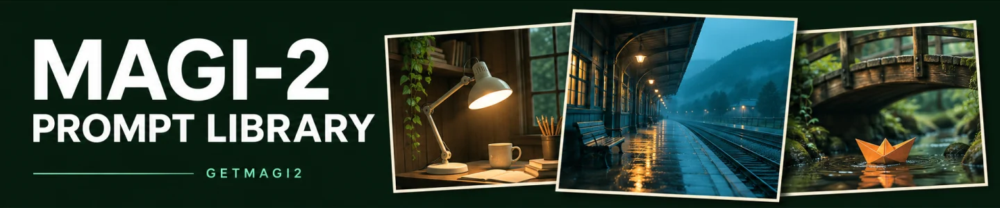
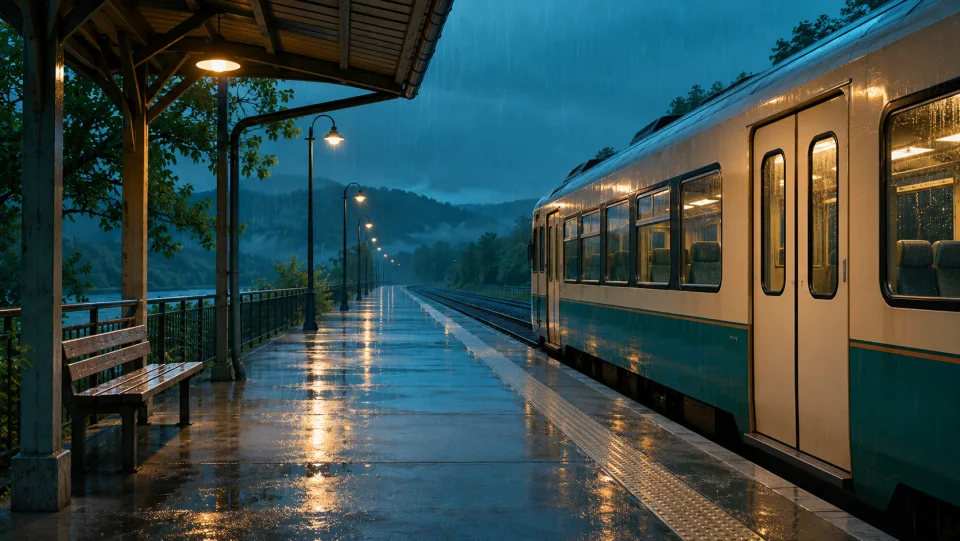
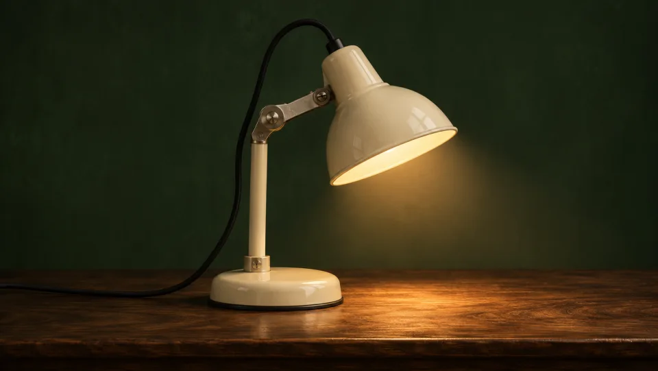
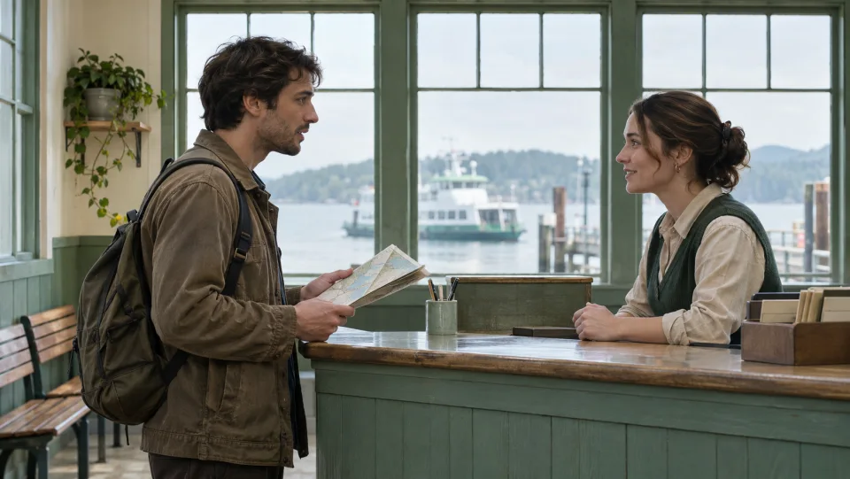
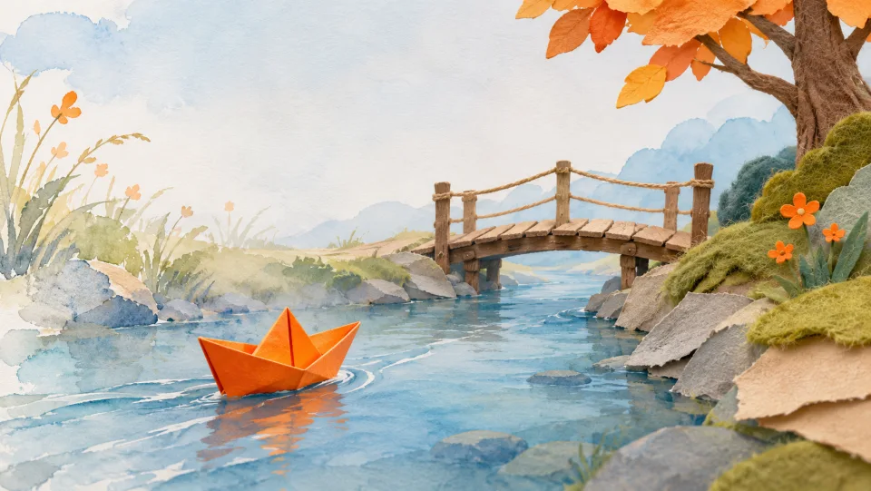
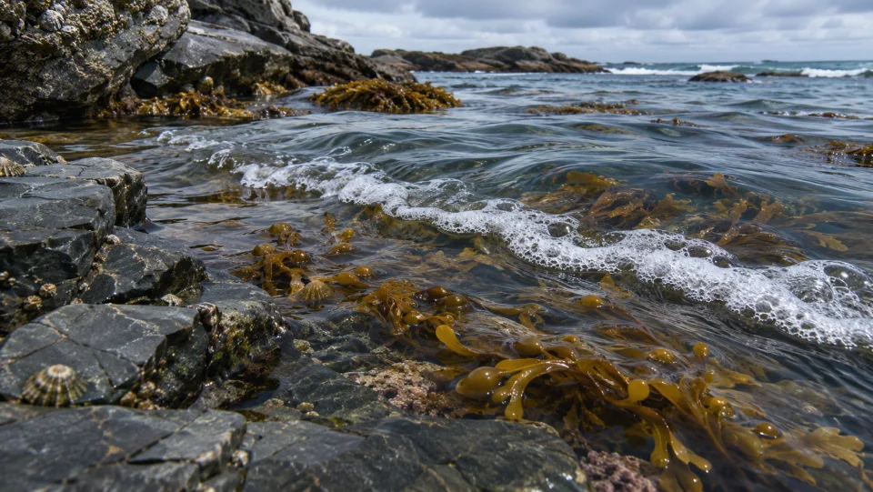
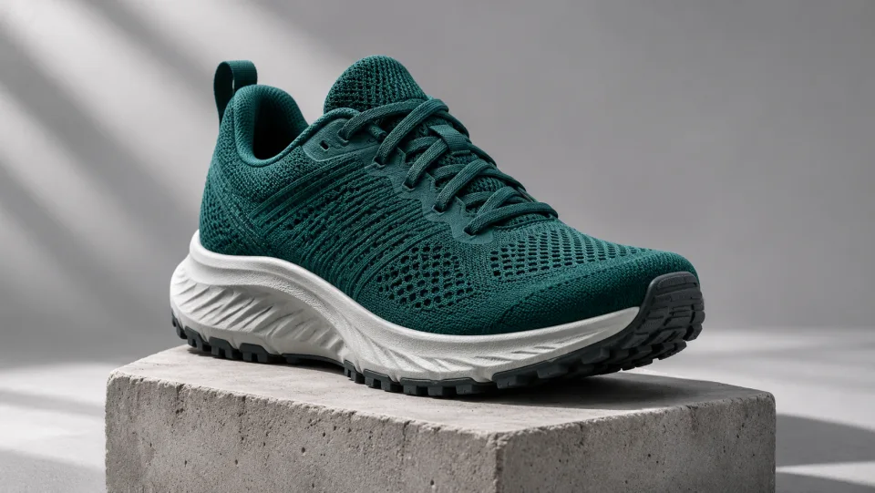
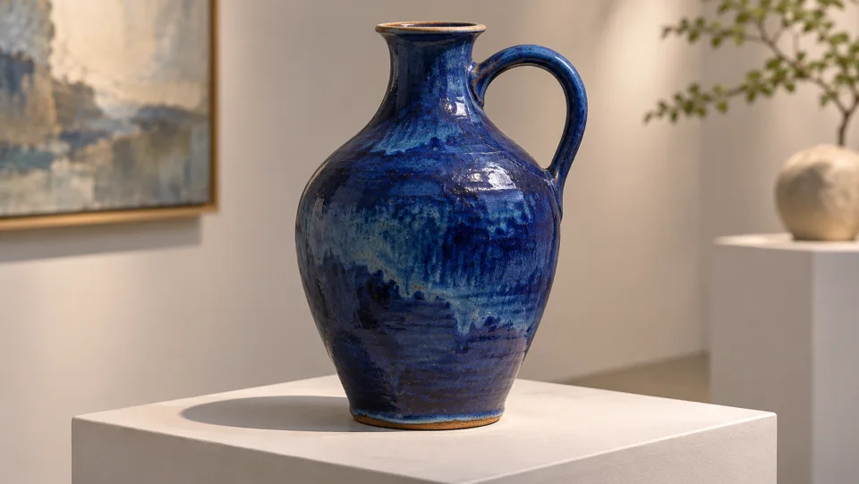
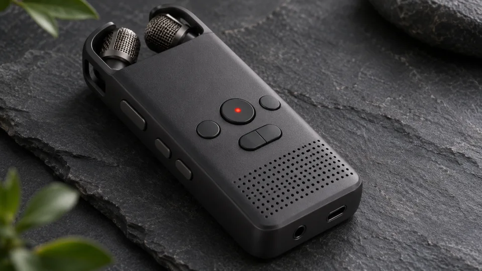
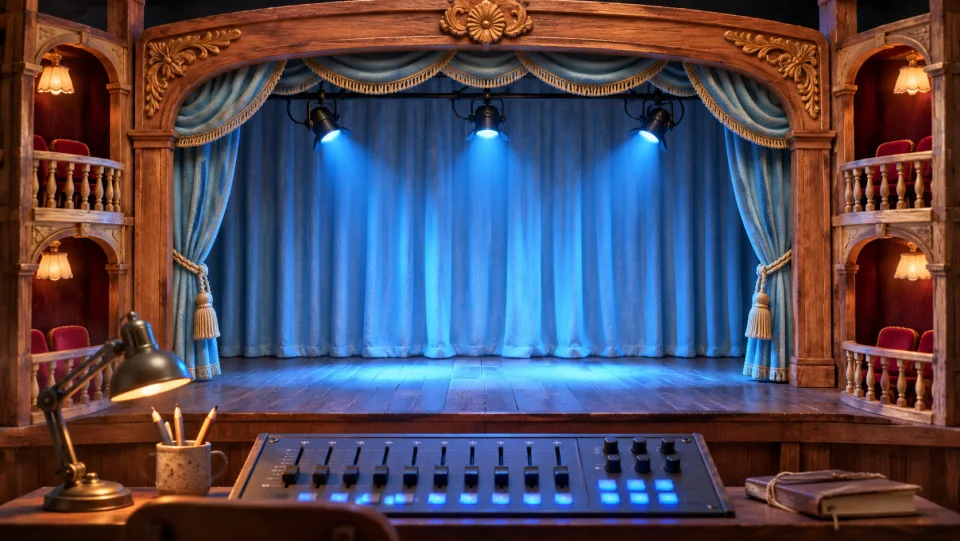

**English** · [简体中文](README.zh-CN.md) · [日本語](README.ja-JP.md) · [Español](README.es-ES.md)

<a href="https://getmagi2.com/?utm_source=github&amp;utm_medium=referral&amp;utm_campaign=magi2_prompt_library&amp;utm_content=cover#tool-generator">
  
</a>

# 🎬 Awesome MAGI-2 Video Prompts

[](https://github.com/Chang-Hai/awesome-magi-2-prompts/stargazers)
[](https://github.com/Chang-Hai/awesome-magi-2-prompts/actions/workflows/validate.yml)

Watch MAGI-2 outputs at their source, study the camera and audio, then adapt a timed video prompt. Each published clip links to its author, its original context, and its playable MP4.

**[Watch MAGI-2 videos](#official-video-gallery) · [Copy a video template](TEMPLATES.md) · [Browse all prompts](PROMPTS.md) · [Open GetMagi2](https://getmagi2.com/text-to-video?model=magi-2&utm_source=github&utm_medium=referral&utm_campaign=magi2_prompt_library&utm_content=readme)**

| Source-checked videos | Exact prompts from sources | Original prompts | Last updated |
| ---: | ---: | ---: | --- |
| 10 | 1 | 14 | 2026-11-25 |

<a name="video-gallery"></a>
<a name="official-video-gallery"></a>

## ▶ Watch MAGI-2 videos

Pick a clip, turn on sound where available, and read the case notes for what to look for. Sample durations, dimensions, frame rates, and audio-stream information describe the distributed files. See the original source for model and workflow claims.

| Video case | Use | Runtime | Evidence | Play |
| --- | --- | ---: | --- | --- |
| [Through Five Art Styles](CASES.md#through-five-art-styles) | Cinematic | 29.8s | Official demo | [▶ Watch Video](https://static.magi.world/media/website/01f847c8f459fa2b2831796dade7fa9b72acdfe5f77538044d455973f07c6362.mp4) |
| [Into the Giant Flower World](CASES.md#into-the-giant-flower-world) | Mixed reference | 16.87s | Official demo | [▶ Watch Video](https://static.magi.world/media/website/7e823798bc17774a51d5f9ef8ad1cf6b1db750058c7c80a24bde83a46d83debc.mp4) |
| [Precision Timeline & Shot-Cut Control](CASES.md#precision-timeline-shot-cuts) | Timeline | 29.8s | Official demo | [▶ Watch Video](https://static.magi.world/media/website/173dba46280a4b05ae603bd9f5b43a1fed9239a815ff5db022381bdf93693018.mp4) |
| [From “Preview” to “MAGI-2”](CASES.md#from-preview-to-magi-2) | Editing | 9.96s | Official demo | [▶ Watch Video](https://static.magi.world/media/website/4a6c7a224b68c5637bd2c1e6cd75d723a205f57cd75a52fbcbe684544dd14c38.mp4) |
| [Cinematic Quality, Close-Up Ready](CASES.md#cinematic-close-up) | Cinematic | 16.76s | Official demo | [▶ Watch Video](https://static.magi.world/media/website/07dde840e694e704982b6b1b17781d0b4849ed024f3423feb12422febf87b622.mp4) |
| [Studio-Quality Ads, Without the Studio](CASES.md#studio-quality-product-ads) | Product ads | 10.4s | Official demo | [▶ Watch Video](https://static.magi.world/media/website/5c5be9adaa2193356db9a80e336972e61440013b638004343c8a6c7b5e7e4e8b.mp4) |
| [Every Character, a Method Actor](CASES.md#every-character-method-actor) | Performance | 19.92s | Official demo | [▶ Watch Video](https://static.magi.world/media/website/eee1aab938a2572da64934fcad9ec311505e823b71e0c0a3eb1dcb8dc0d1437c.mp4) |
| [Boat Dialogue Between Lu Su and Zhuge Liang](CASES.md#boat-dialogue-autonomous-directing) | Dialogue | 15s | Official demo | [▶ Watch Video](https://static.magi.world/media/website/7e0348ab6faac8f74dc85025a0970d6bd73158c132c95d1e5a11cfe42a0cffd9.mp4) |
| [Alpine Lake — After Reinforcement Learning](CASES.md#alpine-lake-after-reinforcement-learning) | Research | 30.16s | Official demo | [▶ Watch Video](https://static.magi.world/media/website/3dafefd20ec804cea9737517b692eadf229dc147437351f58337acc013876b39.mp4) |
| [9×9 Sudoku Probe](CASES.md#sudoku-visual-reasoning-probe) | Research | 7.57s | Published prompt | [▶ Watch Video](https://static.magi.world/media/website/3522a0a956303744982926dce8df03555765e7ff8c7693ba887a3e5d6e60a40a.mp4) |

**[Open the full video case library](CASES.md)** for input evidence, creator attribution, and viewing notes. A linked original exercise is a separate prompt to try.

### What the labels mean

| Label | Evidence available |
| --- | --- |
| **Official demo** | Creator’s published video and source page. Copy-ready original prompt unavailable. |
| **Published prompt** | Creator’s published video and exact input text. Additional settings or references may still be required. |
| **Original template** | A new prompt or timed exercise from this repository. The accompanying still is a storyboard concept. |

## 🚀 Start here

1. Choose a [template by format](TEMPLATES.md) or a complete [original prompt](PROMPTS.md).
2. Replace the bracketed fields. For mixed references, say what each file controls.
3. Open the matching GetMagi2 studio mode, paste the prompt, and check your settings and credit cost.
4. Review the result with the prompt beside it. Check the timing of cuts, movement, or sound before adding complexity.

[Text to video](https://getmagi2.com/text-to-video?model=magi-2&utm_source=github&utm_medium=referral&utm_campaign=magi2_prompt_library&utm_content=start_text) · [Image to video](https://getmagi2.com/image-to-video?model=magi-2&utm_source=github&utm_medium=referral&utm_campaign=magi2_prompt_library&utm_content=start_image) · [Reference to video](https://getmagi2.com/reference-to-video?model=magi-2&utm_source=github&utm_medium=referral&utm_campaign=magi2_prompt_library&utm_content=start_reference)

## 🧩 Reusable video templates

The images below illustrate template briefs. Open a template for the timed prompt, editable fields, and review steps.

<table>
<tr>
<td width="33%" valign="top"><a href="TEMPLATES.md#continuous-cinematic-take"></a><br><b><a href="TEMPLATES.md#continuous-cinematic-take">Continuous cinematic take</a></b><br><sub>One camera move and continuous ambience.</sub></td>
<td width="33%" valign="top"><a href="TEMPLATES.md#product-ad-with-mixed-references"></a><br><b><a href="TEMPLATES.md#product-ad-with-mixed-references">Product ad with mixed references</a></b><br><sub>Keep the product consistent across two angles.</sub></td>
<td width="33%" valign="top"><a href="TEMPLATES.md#two-person-dialogue-and-reactions"></a><br><b><a href="TEMPLATES.md#two-person-dialogue-and-reactions">Two-person dialogue</a></b><br><sub>Time the lines, pause, and reaction.</sub></td>
</tr>
</table>

[Open all six templates](TEMPLATES.md), including a 30-second shot list, first-and-last-frame setup, and a measurable sound cue.

## 🔁 Cross-model retests

Published reruns: **0**. The video cases above are source-checked examples. Use the protocol to compare your own MAGI-2 run with another model and submit both successful and failed attempts.

[Read the retest protocol](docs/RETEST.md) · [Submit a video case or retest](https://github.com/Chang-Hai/awesome-magi-2-prompts/issues/new?template=video-case.yml)

## 🏷️ Browse original prompts by use case

- [Product and e-commerce](#product-and-e-commerce) · Product reveals, consistent packaging, readable details, and short ad formats.
- [Cinematic scenes](#cinematic-scenes) · Slow camera moves, continuous atmosphere, and natural environmental sound.
- [Dialogue and sound](#dialogue-and-sound) · Two-person dialogue, timing a sound effect, and keeping ambience continuous through action.
- [Miniatures and animation](#miniatures-and-animation) · Handmade sets, style transitions, and controlled camera reveals.

**By input** · [Text to video](PROMPTS.md#text-to-video) · [Image to video](PROMPTS.md#image-to-video) · [Reference to video](PROMPTS.md#reference-to-video)

<a name="what-is-magi-2"></a>

## Model and provider notes

Sand.ai’s hosted flagship supports up to 30 seconds of 1080p video at 25 fps and generates sound alongside the video. The downloadable 114B MAGI-2 Preview uses a separate workflow with fixed 10-second output. Providers can expose different input modes, output settings, and prices. [Sand.ai flagship release](https://sand.ai/blog/magi-2) · [Preview repository](https://github.com/SandAI-org/MAGI-2-preview) · [Provider and pricing FAQ](docs/FAQ.md)

<a name="featured-prompts"></a>

## ⭐ Featured original prompts

<a name="two-angle-desk-lamp"></a>

### 1. Two-angle desk lamp launch

`Reference to video` · `12s` · `16:9` · `Product commercial` · `Sound cue`

**Description**

A short product spot that uses two photos to preserve the lamp’s appearance and a phone clip to guide the camera. The switch click lands when the light comes on.

**Prompt**

```text
Use the front photo to match the cream shade and the side photo to match the hinge and cord. Take only the camera direction and pace from the reference video. From 0–5 seconds, slide left across the dark desk, keeping the complete lamp in frame. Cut at 5 seconds to a fixed view of the hinge. A hand flips the switch once at 7 seconds. Add a single small click as the lamp lights up. At 9 seconds cut back to a steady wide shot and hold the same pool of light through the end.
```

**Storyboard preview**

<p align="center">
  
</p>

*AI-generated concept still illustrating the brief.*

**Inputs and output checks**

Upload:

- Front and side photos of the same desk lamp
- A phone clip showing the intended lateral camera slide

- The front and side views show the same hinge and cord position.
- The click and the first visible change in brightness occur together.

**Details** · GetMagi2 Editorial · Original prompt · English · 2026-11-25

**[Try reference to video on GetMagi2](https://getmagi2.com/reference-to-video?model=magi-2&utm_source=github&utm_medium=referral&utm_campaign=magi2_prompt_library&utm_content=two-angle-desk-lamp)** · [Copy-ready catalog](PROMPTS.md#two-angle-desk-lamp)

---

<a name="rain-platform-departure"></a>

### 2. Rainy station departure in one take

`Text to video` · `10s` · `21:9` · `Cinematic` · `Continuous shot`

**Description**

A continuous blue-hour shot with a fixed camera. The door tone, train movement, and fading hum give the clip a clear sequence.

**Prompt**

```text
One continuous wide shot from waist height at an empty above-ground train platform at blue hour. A stationary regional train waits on the right. Fine rain catches the platform lights and makes a pale reflection on the concrete. Keep the camera fixed. Sound begins with rain and an idle electric hum. At 4 seconds, add one short door tone and let the visible door finish closing. At 6 seconds, the train begins to roll right; the hum fades as it leaves frame. Hold on the empty platform for the final second.
```

**Storyboard preview**

<p align="center">
  
</p>

*AI-generated concept still illustrating the brief.*

**Inputs and output checks**

- Check that the door closes before the train begins moving.
- Look for steady platform geometry and listen for the order of tone, motion and fade.

**Details** · GetMagi2 Editorial · Original prompt · English · 2026-11-25

**[Try text to video on GetMagi2](https://getmagi2.com/text-to-video?model=magi-2&utm_source=github&utm_medium=referral&utm_campaign=magi2_prompt_library&utm_content=rain-platform-departure)** · [Copy-ready catalog](PROMPTS.md#rain-platform-departure)

---

<a name="ferry-ticket-hall-dialogue"></a>

### 3. Two lines of dialogue in a ferry ticket hall

`Text to video` · `14s` · `21:9` · `Dialogue` · `Lip sync`

**Description**

A short, two-person exchange with a pause and a visible reaction. Both faces stay in frame for checking lip sync and speaker order.

**Prompt**

```text
Use one medium-wide shot of a traveler and a ticket clerk at a small ferry terminal. Between 0 and 3 seconds, hold both people in frame as the traveler looks up from a folded map. At 3 seconds the traveler asks, [line one: “Where do I board for the island?”]. Leave a brief pause. At about 7 seconds the clerk replies, [line two: “The second gate on your left.”]. Let the traveler nod after the answer. Ease the camera forward from 9 to 13 seconds. Keep a distant ventilation hum beneath the exchange, soft enough to hear both voices clearly.
```

**Storyboard preview**

<p align="center">
  
</p>

*AI-generated concept still illustrating the brief.*

**Inputs and output checks**

- Both lines are audible in the intended order, with a discernible pause between speakers.
- Each speaking voice matches the mouth movement of its speaker, and the listener keeps their mouth still during the other line.
- The nod follows the answer and both people stay in frame during the approach.

**Details** · GetMagi2 Editorial · Original prompt · English · 2026-11-25

**[Try text to video on GetMagi2](https://getmagi2.com/text-to-video?model=magi-2&utm_source=github&utm_medium=referral&utm_campaign=magi2_prompt_library&utm_content=ferry-ticket-hall-dialogue)** · [Copy-ready catalog](PROMPTS.md#ferry-ticket-hall-dialogue)

---

<a name="paper-boat-style-transition"></a>

### 4. Paper boat through two visual styles

`Text to video` · `14s` · `16:9` · `Animation` · `Style transition`

**Description**

One paper boat travels through a watercolor scene and into a handmade miniature. Its direction and the sound of the water carry through the style change.

**Prompt**

```text
A small orange paper boat drifts from left to right along a shallow gutter in one continuous low tracking shot. From 0–6 seconds, render the street as a soft hand-painted watercolor with loose washes. Between 6 and 9 seconds, the boat passes under a small wooden footbridge and the materials gradually resolve into felt and layered paper. From 9–14 seconds, maintain the same boat shape and motion in the new tactile miniature style. A soft trickle of water continues through the transition. Keep one direction of travel and no cuts.
```

**Storyboard preview**

<p align="center">
  
</p>

*AI-generated concept still illustrating the brief.*

**Inputs and output checks**

- The bow and orange paper fold match before and after the style change.
- Watch for an unintended cut or break in water ambience under the bridge.

**Details** · GetMagi2 Editorial · Original prompt · English · 2026-11-25

**[Try text to video on GetMagi2](https://getmagi2.com/text-to-video?model=magi-2&utm_source=github&utm_medium=referral&utm_campaign=magi2_prompt_library&utm_content=paper-boat-style-transition)** · [Copy-ready catalog](PROMPTS.md#paper-boat-style-transition)

---

<a name="tidepool-ebb-sound"></a>

### 5. A tidepool fills and recedes

`Reference to video` · `18s` · `4:3` · `Mixed references` · `Field sound`

**Description**

An image defines the rocks, a video shows the direction of the wave, and an audio reference guides the wash and its quiet bubbling tail.

**Prompt**

```text
Open on the rock shelf in the image reference at low tide. For the first four seconds, glide the camera a little forward, keeping the same arrangement of dark stones and [foreground detail: amber seaweed]. Use the motion reference to guide the water. At 5 seconds a shallow wave enters from the left, with the wash audible as the white edge reaches the stones. From 8 to 14 seconds let the water drain back in the same direction and reveal the seaweed. Use the field recording to guide the wash and a brief bubbling sound as the last water settles. Hold the final framing through 18 seconds.
```

**Storyboard preview**

<p align="center">
  
</p>

*AI-generated concept still illustrating the brief.*

**Inputs and output checks**

Upload:

- Image reference of the rock shelf showing the target composition and rock colors
- Motion reference clip of a shallow wave entering and receding from a small tidepool
- Field audio reference of soft wash, with one quiet bubbling tail

- The water enters from the left between 4 and 6 seconds, and the sound of the wash begins as it reaches the foreground stones.
- The same foreground stones stay in view as the water drains, with the foreground detail visible by 14 seconds.
- The bubbling tail follows the retreating wave and fades before the end.

**Details** · GetMagi2 Editorial · Original prompt · English · 2026-11-25

**[Try reference to video on GetMagi2](https://getmagi2.com/reference-to-video?model=magi-2&utm_source=github&utm_medium=referral&utm_campaign=magi2_prompt_library&utm_content=tidepool-ebb-sound)** · [Copy-ready catalog](PROMPTS.md#tidepool-ebb-sound)

<a name="all-prompts"></a>

## 📋 All original prompts

<a name="product-and-e-commerce"></a>

### Product and e-commerce

Product reveals, consistent packaging, readable details, and short ad formats.

<a name="running-shoe-vertical-reveal"></a>

#### 6. Running shoe reveal for a vertical ad

`Image to video` · `8s` · `9:16` · `Vertical ad` · `Product photography`

**Description**

An eight-second vertical product reveal that keeps the shoe’s construction visible and reserves space for a caption.

**Prompt**

```text
Use the supplied product photo as the opening frame of an eight-second vertical ad. Keep the actual toe shape, lace pattern, upper color and sole profile. At 0–3 seconds, push in slowly from the original three-quarter view while a narrow band of window light travels across the upper. At 3–6 seconds, stop the push and let the light reveal the stitching and rubber tread. Hold the full shoe in frame at 6–8 seconds. Use faint room tone. Leave clear space above the shoe for a caption to be added in editing.
```

**Storyboard preview**

<p align="center">
  
</p>

*AI-generated concept still illustrating the brief.*

**Inputs and output checks**

Upload:

- A vertical product photo of your own unbranded running shoe

- Compare the sole outline and count the lace eyelets in the first and last frames.
- Check that the shoe stays inside the vertical crop with space for a caption.

**Details** · GetMagi2 Editorial · Original prompt · English · 2026-11-25

**[Try image to video on GetMagi2](https://getmagi2.com/image-to-video?model=magi-2&utm_source=github&utm_medium=referral&utm_campaign=magi2_prompt_library&utm_content=running-shoe-vertical-reveal)** · [Copy-ready catalog](PROMPTS.md#running-shoe-vertical-reveal)

**Featured** · [Two-angle desk lamp launch](#two-angle-desk-lamp)

<a name="tea-steam-packshot"></a>

#### 7. A quiet tea packshot with room for copy

`Image to video` · `6s` · `4:3` · `Packshot` · `Food and drink`

**Description**

A quiet product shot with controlled steam and gentle window light. The product stays fixed and the frame has room for sales copy.

**Prompt**

```text
Begin with the supplied still of a tea box and a clear cup on a dark wooden counter. For the full six seconds, keep the camera fixed and the package front unchanged. A small ribbon of steam begins above the cup and drifts toward the window. A soft shadow moves very slowly across the background while the packaging stays readable. Use low kitchen room tone. Keep the upper right open for a price card added later.
```

**Storyboard preview**

<p align="center">
  
</p>

*AI-generated concept still illustrating the brief.*

**Inputs and output checks**

Upload:

- A still of your product package next to a glass of tea

- Pause at 0, 3 and 6 seconds and check the shape and placement of the package and label.
- Check that steam never covers the area reserved for the price card.

**Details** · GetMagi2 Editorial · Original prompt · English · 2026-11-25

**[Try image to video on GetMagi2](https://getmagi2.com/image-to-video?model=magi-2&utm_source=github&utm_medium=referral&utm_campaign=magi2_prompt_library&utm_content=tea-steam-packshot)** · [Copy-ready catalog](PROMPTS.md#tea-steam-packshot)

<a name="ceramic-vase-listing-fidelity"></a>

#### 8. Preserve a ceramic vase in a product orbit

`Reference to video` · `8s` · `16:9` · `E-commerce` · `Object consistency`

**Description**

A narrow camera orbit built around two views of the same vase. Use it to check whether the handle, rim, and glaze stay consistent across angles.

**Prompt**

```text
Use the front image for the vase's height, lip and blue glaze. Use the three-quarter image for the curve of the handle. Over eight seconds move the camera only far enough to reveal that handle and stop. The vase stays on the same white plinth under a soft key light throughout. Carry over only the speed of the optional motion reference. Avoid any change in glaze, rim width, handle join, or background shape. Use quiet gallery ambience.
```

**Storyboard preview**

<p align="center">
  
</p>

*AI-generated concept still illustrating the brief.*

**Inputs and output checks**

Upload:

- Front and three-quarter photos of the same ceramic vase
- An optional short clip demonstrating the camera speed

- Match the handle shape through the turn and count the visible handles before and after.
- Compare the rim width and glaze color to both reference photos.

**Details** · GetMagi2 Editorial · Original prompt · English · 2026-11-25

**[Try reference to video on GetMagi2](https://getmagi2.com/reference-to-video?model=magi-2&utm_source=github&utm_medium=referral&utm_campaign=magi2_prompt_library&utm_content=ceramic-vase-listing-fidelity)** · [Copy-ready catalog](PROMPTS.md#ceramic-vase-listing-fidelity)

<a name="field-recorder-close-up"></a>

#### 9. Field recorder demo with a readable final frame

`Image to video` · `9s` · `3:4` · `Product demo` · `Macro`

**Description**

A short demonstration that shows a record button press, an indicator light, and a synchronized click. It reserves space for a caption.

**Prompt**

```text
Start with the supplied diagonal view of a handheld field recorder on a slate surface. Hold the recorder still. For 0–4 seconds, bring the camera gently lower until the record button is near center. At 5 seconds, one index finger presses the button and the red indicator comes on. A soft tactile click lines up with the press. Hold the new angle with room below the device for a label added in post. Keep all ports and buttons in their original positions.
```

**Storyboard preview**

<p align="center">
  
</p>

*AI-generated concept still illustrating the brief.*

**Inputs and output checks**

Upload:

- A clean product photo of your field recorder from a diagonal angle

- Look for any renamed controls or extra ports before using the clip commercially.
- Pause at the press and check that the indicator changes and the click is heard at that instant.

**Details** · GetMagi2 Editorial · Original prompt · English · 2026-11-25

**[Try image to video on GetMagi2](https://getmagi2.com/image-to-video?model=magi-2&utm_source=github&utm_medium=referral&utm_campaign=magi2_prompt_library&utm_content=field-recorder-close-up)** · [Copy-ready catalog](PROMPTS.md#field-recorder-close-up)

---

<a name="cinematic-scenes"></a>

### Cinematic scenes

Slow camera moves, continuous atmosphere, and natural environmental sound.

**Featured** · [Rainy station departure in one take](#rain-platform-departure)

**Featured** · [A tidepool fills and recedes](#tidepool-ebb-sound)

---

<a name="dialogue-and-sound"></a>

### Dialogue and sound

Two-person dialogue, timing a sound effect, and keeping ambience continuous through action.

<a name="orchard-crate-foley"></a>

#### 10. An orchard crate lands on a wooden table

`Text to video` · `6s` · `16:9` · `Foley` · `Food and drink`

**Description**

A close shot built around one wooden thump and one rolling pear. It makes the synchronization point easy to see and hear.

**Prompt**

```text
Make a six-second close-up of a farm worker setting a shallow crate of [fruit: green pears] onto an outdoor packing table. Begin with the crate held just above the table. At 1.5 seconds the crate touches down with one low wooden thump. One pear rolls a few centimeters and settles around 2.5 seconds. Move the camera slowly right, keeping the crate rim and the rolling pear in focus. Use distant birds and a low rustle of leaves for the rest of the sound bed.
```

**Storyboard preview**

<p align="center">
  
</p>

*AI-generated concept still illustrating the brief.*

**Inputs and output checks**

- The crate makes visible contact at 1.5 seconds within half a second, and the thump lands within 150 milliseconds of that contact.
- One pear rolls and stops before the fourth second, with the crate shape and the direction of the camera move consistent through the shot.

**Details** · GetMagi2 Editorial · Original prompt · English · 2026-11-25

**[Try text to video on GetMagi2](https://getmagi2.com/text-to-video?model=magi-2&utm_source=github&utm_medium=referral&utm_campaign=magi2_prompt_library&utm_content=orchard-crate-foley)** · [Copy-ready catalog](PROMPTS.md#orchard-crate-foley)

**Featured** · [Two lines of dialogue in a ferry ticket hall](#ferry-ticket-hall-dialogue)

<a name="ink-roller-pass"></a>

#### 11. An ink roller crosses a printmaking bench

`Image to video` · `8s` · `3:4` · `Art process` · `Foley`

**Description**

An overhead tabletop scene in which one roller makes a single timed pass. Its sound begins and ends with visible contact.

**Prompt**

```text
Start with the overhead arrangement in the supplied photograph. Keep the plate and the camera fixed. At 2 seconds, a hand takes the roller from the upper-left corner. At 3 seconds the roller meets the plate and makes a quiet tacky sound. From 3 to 6 seconds, make one slow pass toward the lower edge, spreading a thin layer of [ink color: deep blue]. Let the rolling sound continue while the roller is in contact. At 6 seconds lift the roller with a brief release sound, then hold on the inked plate.
```

**Storyboard preview**

<p align="center">
  
</p>

*AI-generated concept still illustrating the brief.*

**Inputs and output checks**

Upload:

- First-frame overhead photo of a clean roller, a blank printing plate, and a dab of ink in the intended color

- The first frame uses the same camera angle and object positions as the reference photo.
- The rolling sound starts on contact and stops within 200 milliseconds of the lift.
- The roller makes one continuous pass, and the ink stays within the plate edges.

**Details** · GetMagi2 Editorial · Original prompt · English · 2026-11-25

**[Try image to video on GetMagi2](https://getmagi2.com/image-to-video?model=magi-2&utm_source=github&utm_medium=referral&utm_campaign=magi2_prompt_library&utm_content=ink-roller-pass)** · [Copy-ready catalog](PROMPTS.md#ink-roller-pass)

<a name="paper-mobile-window"></a>

#### 12. A paper mobile turns beside a window

`Image to video` · `10s` · `1:1` · `First and last frames` · `Soft motion`

**Description**

A slow movement exercise with countable paper shapes and one quiet contact sound. An optional end frame helps set the resting angle.

**Prompt**

```text
Start on the supplied image. Between 1 and 5 seconds, a draft slowly turns the handmade paper mobile until its largest shape is nearly face-on. Keep the camera fixed. At about 5 seconds, two pieces of [paper color: off-white] brush once, with a delicate papery rasp. Let the movement diminish over the next three seconds and settle into the supplied final composition if a final frame is present. Preserve the number of paper shapes and their thread positions. Use a low indoor room tone throughout.
```

**Storyboard preview**

<p align="center">
  
</p>

*AI-generated concept still illustrating the brief.*

**Inputs and output checks**

Upload:

- First-frame photo of an unbranded handmade paper mobile in the starting position
- Optional final-frame photo of the same mobile at the desired resting angle in the same light

- Count the same number of paper pieces at the start, at maximum turn, and at rest.
- The rasp coincides with visible paper contact within 200 milliseconds.
- If a final-frame image is supplied, the largest piece has the same orientation in the ending composition.

**Details** · GetMagi2 Editorial · Original prompt · English · 2026-11-25

**[Try image to video on GetMagi2](https://getmagi2.com/image-to-video?model=magi-2&utm_source=github&utm_medium=referral&utm_campaign=magi2_prompt_library&utm_content=paper-mobile-window)** · [Copy-ready catalog](PROMPTS.md#paper-mobile-window)

---

<a name="miniatures-and-animation"></a>

### Miniatures and animation

Handmade sets, style transitions, and controlled camera reveals.

**Featured** · [Paper boat through two visual styles](#paper-boat-style-transition)

<a name="miniature-bakery-finish"></a>

#### 13. Miniature bakery from a fixed first frame

`Image to video` · `8s` · `1:1` · `Miniature` · `Sound cue`

**Description**

A fixed starting scene in a miniature bakery, ending on a brass counter bell. A paper bag and the bell provide two simple timed actions.

**Prompt**

```text
Keep the supplied miniature bakery as the starting frame. Use a slow, shallow camera tilt from the middle tray to a counter bell, keeping exactly three trays visible until the angle naturally crops them. Between 3 and 5 seconds, one paper bag is placed next to the bell by a single hand. Let the bag settle. At 6 seconds, the hand taps the bell once. Hold on the bell and bag for the rest of the square clip with very quiet room tone.
```

**Storyboard preview**

<p align="center">
  
</p>

*AI-generated concept still illustrating the brief.*

**Inputs and output checks**

Upload:

- A still of a miniature bakery counter with three bread trays

- Check that the trays remain fixed in place as the camera tilts.
- Make sure the bell is tapped once and the ring follows the tap.

**Details** · GetMagi2 Editorial · Original prompt · English · 2026-11-25

**[Try image to video on GetMagi2](https://getmagi2.com/image-to-video?model=magi-2&utm_source=github&utm_medium=referral&utm_campaign=magi2_prompt_library&utm_content=miniature-bakery-finish)** · [Copy-ready catalog](PROMPTS.md#miniature-bakery-finish)

<a name="miniature-stage-light-cue"></a>

#### 14. A miniature stage lights up on cue

`Reference to video` · `24s` · `9:16` · `Miniature` · `Timing and cuts`

**Description**

A miniature theater rehearsal with a timed switch, a rising camera, and two short voice cues around the reveal.

**Prompt**

```text
Make a 24-second vertical scene at a miniature stage rehearsal. For 0 to 6 seconds, show the operator's hand near the single switch on the desk from the image. An adult offscreen says, [cue line: “Ready for the blue wash?”], at 4 seconds. At 7 seconds the hand flips the switch with one relay click like the audio reference. Show the pale blue stage light starting on that same beat. From 8 to 16 seconds follow the slow camera rise in the motion reference and reveal the curtain and the lit set from the stage image. At 17 seconds an adult with a different voice replies, [response line: “Hold that level.”]. Keep the set still from 19 seconds to the end, with a quiet ventilation hum beneath the dialogue.
```

**Storyboard preview**

<p align="center">
  
</p>

*AI-generated concept still illustrating the brief.*

**Inputs and output checks**

Upload:

- Image reference of a handmade miniature stage and its pale blue curtain
- Image reference of the lighting operator's desk and its single rocker switch
- Motion reference clip of a slow camera rise from desk height to stage height
- Audio reference recording of the relay click and low ventilation hum

- The switch moves, the relay clicks, and the blue light comes on within a 250-millisecond window.
- Both spoken lines can be understood, in order, with the relay quieter than the dialogue.
- The rise reveals the miniature set without cutting, and the stage proportions and curtain color match the references at the end.

**Details** · GetMagi2 Editorial · Original prompt · English · 2026-11-25

**[Try reference to video on GetMagi2](https://getmagi2.com/reference-to-video?model=magi-2&utm_source=github&utm_medium=referral&utm_campaign=magi2_prompt_library&utm_content=miniature-stage-light-cue)** · [Copy-ready catalog](PROMPTS.md#miniature-stage-light-cue)

<a name="how-to-contribute"></a>

## Contributing

Share an original prompt, a publicly sourced video, or a documented retest. Give the author and source, mark which inputs are available, and include permission details for any assets you submit. [Contribution guidelines](docs/CONTRIBUTING.md) · [Local development](docs/LOCAL_DEVELOPMENT.md) · [Video case data](data/video-cases.json)

Maintained by [GetMagi2](https://getmagi2.com/), an independent online studio and model guide. Formatting and evidence practices are informed by [LearnPrompt’s Awesome Seedance](https://github.com/LearnPrompt/awesome-seedance) and [YouMind’s Seedance 2 prompts](https://github.com/YouMind-OpenLab/awesome-seedance-2-prompts).
