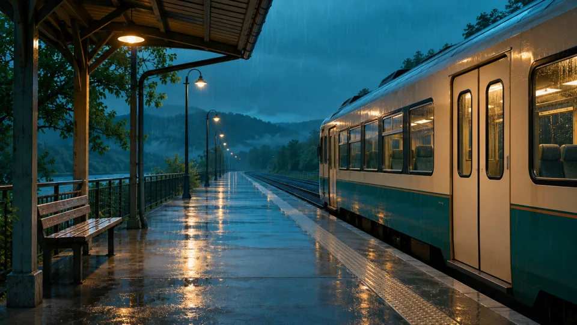

<a href="https://getmagi2.com/?utm_source=github&amp;utm_medium=referral&amp;utm_campaign=magi2_prompt_library&amp;utm_content=readme_zh#tool-generator">
  
</a>

# 🎬 MAGI-2 精选提示词库

[English](README.md) · **简体中文** · [日本語](README.ja-JP.md) · [Español](README.es-ES.md)

这套提示词适合用 Sand.ai 的 MAGI-2 制作产品广告、电影镜头、人物对白和有声短片。每条英文提示词附建议时长、画幅、参考素材和成片检查项。

**[阅读完整提示词库](README.md#all-prompts)** · **[观看 Sand.ai 官方样片](README.md#official-video-gallery)** · **[打开 GetMagi2 工作室](https://getmagi2.com/text-to-video?model=magi-2&utm_source=github&utm_medium=referral&utm_campaign=magi2_prompt_library&utm_content=readme_zh)**

## 🏷️ 按用途找提示词

| 用途 | 查看案例 |
| --- | --- |
| 产品与电商 | [竖屏跑鞋广告、双角度台灯、商品特写](README.md#product-and-e-commerce) |
| 电影场景 | [雨夜站台一镜到底、潮池进退潮](README.md#cinematic-scenes) |
| 对白与音效 | [渡轮售票厅对白、果箱落桌、油墨滚轮](README.md#dialogue-and-sound) |
| 微缩场景与动画 | [纸船变换画风、迷你面包房、舞台灯光](README.md#miniatures-and-animation) |

也可以按素材筛选。[文生视频](PROMPTS.md#text-to-video) · [图生视频](PROMPTS.md#image-to-video) · [多素材参考](PROMPTS.md#reference-to-video)

## ⭐ 精选提示词

### 双角度台灯广告

使用同一台台灯的正面和侧面照片锁定外观，再用一段手机视频示范左移运镜。开关声和亮灯应该落在同一刻。

**多素材参考 · 12 秒 · 16:9**

<p align="center">
  
</p>

*AI 生成的概念分镜，用于说明预期画面。*

```text
用正面照片保留奶油色灯罩，用侧面照片保留铰链和电线。参考视频只用于确定运镜方向和速度。0–5 秒，镜头在深色桌面左移，让完整台灯始终入镜。第 5 秒切到铰链的固定特写。第 7 秒，一只手拨动开关，台灯亮起，同时响起一次轻微的咔嗒声。第 9 秒切回稳定的广角，保持同一片灯光直至结束。
```

回看时，比较两个角度的铰链和电线位置。再暂停在亮度变化的第一帧，听开关声是否对齐。

**[尝试多素材参考](https://getmagi2.com/reference-to-video?model=magi-2&utm_source=github&utm_medium=referral&utm_campaign=magi2_prompt_library&utm_content=two-angle-desk-lamp)** · [英文提示词与完整检查项](README.md#two-angle-desk-lamp)

### 雨夜站台一镜到底

把车门关闭、提示音和列车启动写成有先后顺序的三个动作，通过固定机位检验动作与声音是否对齐。

**文生视频 · 10 秒 · 21:9**

<p align="center">
  
</p>

*AI 生成的概念分镜，用于说明预期画面。*

```text
傍晚蓝调时刻，在空旷的地面站台拍一个腰部高度的固定广角镜头。区域列车停在画面右侧，细雨从站台灯前穿过，在湿地面形成浅色反光。片头只有雨声和列车低沉的电流声。第 4 秒响起一声短促的关门提示，画面里的车门随后合拢。第 6 秒列车向右启动，驶出画面时电流声逐渐变弱。最后一秒定格在空站台。
```

检查车门先关、列车后动。回放时注意提示音、启动和声音淡出的顺序，以及站台线条有无变形。

**[尝试文生视频](https://getmagi2.com/text-to-video?model=magi-2&utm_source=github&utm_medium=referral&utm_campaign=magi2_prompt_library&utm_content=rain-platform-departure)** · [英文提示词与完整检查项](README.md#rain-platform-departure)

## 🎞️ 官方成片与仓库示意图区别

[官方视频画廊](README.md#official-video-gallery)链接到 Sand.ai 发布的实际视频。仓库案例图是独立制作的概念分镜，展示提示词意图。尝试时请复制文字到工作室，上传自己的参考素材，再核对模型、时长和积分。

Sand.ai 旗舰版支持最长 30 秒的 1080p 同步有声视频。可下载的 114B MAGI-2 Preview 官方流程固定生成 10 秒片段。 [Sand.ai 发布说明](https://sand.ai/blog/magi-2) · [Preview 推理代码](https://github.com/SandAI-org/MAGI-2-preview)

由 [GetMagi2](https://getmagi2.com/) 团队维护，GetMagi2 是独立模型指南和在线工作室。 [贡献指南](docs/CONTRIBUTING.md)
